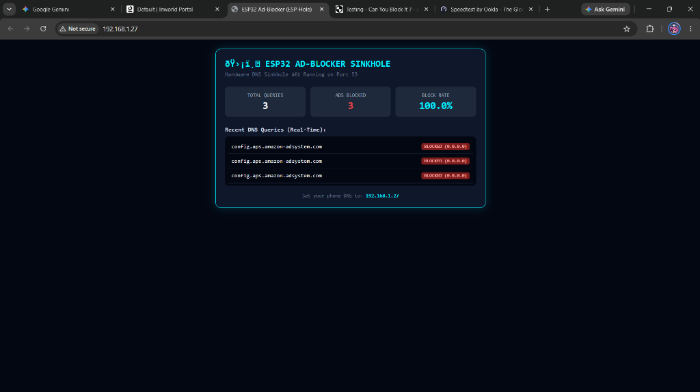

# 🛡️ ESP-Hole: The $4 Hardware DNS Sinkhole for ESP32

[](https://espressif.com)
[](https://github.com/espressif/arduino-esp32)
[]()
[](LICENSE)

> A lightweight, standalone **Hardware DNS Sinkhole** running on a standard **$4 ESP32 microcontroller**. Blocks network-wide mobile app ads, web banners, popups, and telemetry trackers before they ever reach your phone or computer.

---

## 📸 Real-World Proof & Live Dashboard

Below is the live dark-cyberpunk web dashboard hosted directly on the ESP32 (`http://<esp32-ip>/`), showing real-time interception and blocking of ad trackers:



```text
[*] Testing AD DOMAIN: googleads.g.doubleclick.net ...
Server:  UnKnown
Address: 192.168.1.27

Non-authoritative answer:
Name:    googleads.g.doubleclick.net
Addresses:  0.0.0.0, 0.0.0.0  <-- SINKHOLED & BLOCKED!
```

---

## ⚡ How It Works

Instead of running a heavy 24/7 Raspberry Pi or Docker container, **ESP-Hole** transforms an ultra-low-power (~0.5W) ESP32 into an in-line DNS resolver:

```text
[Phone / PC / Tablet]
       │
       │ (DNS Query on UDP Port 53)
       ▼
 [ ESP-Hole (ESP32) ] ── (Is it an Ad / Tracker?)
       │                                  │
       ├─── YES ──> Returns 0.0.0.0       └─── NO ──> Forwards upstream
       │            (Ad blocked instantly!)           (Cloudflare / Router / 8.8.8.8)
       ▼                                              │
[Live Web Dashboard] <────────────────────────────────┘
(Updates counters & logs)
```

1. **UDP Port 53 Server:** Listens for DNS resolution requests from any device on your Wi-Fi.
2. **0.0.0.0 Sinkhole:** If a domain matches an ad network (Google AdMob, DoubleClick, UnityAds, AppLovin, Amazon AdSystem, Taboola, Outbrain, etc.), the ESP32 instantly responds with `0.0.0.0`. The ad never downloads, saving mobile bandwidth and battery!
3. **Smart Upstream Forwarding:** Clean queries are forwarded to your local router DNS (`WiFi.dnsIP()`) with secondary Google DNS (`8.8.8.8`) fallback.
4. **Live Cyberpunk Web Dashboard:** Hosts a sleek, responsive HTML5 dashboard on Port 80 (`http://<esp32-ip>/`) auto-refreshing every 3 seconds with real-time stats and query logs.

---

## 📦 What's in the Box?

| Tool | Purpose |
| :--- | :--- |
| **`ESP-Hole.ino`** | Main standalone firmware. Compatible with any ESP32 board. |
| **`upload_esp32.bat`** | 1-Click compiler and flasher. Bypasses Arduino IDE bugs. |
| **`open_serial_monitor.bat`** | 1-Click terminal monitor. Displays IP address with zero driver lock issues. |
| **`simulate_adblock_test.bat`** | Automated simulation tool that blasts real ad and clean queries to test your sinkhole. |

---

## 🚀 Quick Start Guide

### 1. Hardware Requirements
- Any **ESP32 DevKit** (ESP-WROOM-32, NodeMCU-32S, Seeed Studio XIAO ESP32-S3, etc.).
- Micro-USB or USB-C **data cable**.

### 2. Configure Wi-Fi
Open `ESP-Hole.ino` and enter your 2.4 GHz Wi-Fi credentials:
```cpp
const char* WIFI_SSID = "YOUR_WIFI_NAME";
const char* WIFI_PASS = "YOUR_WIFI_PASSWORD";
```

### 3. Flash to ESP32 (Two Methods)

#### Method A: 1-Click Batch Flasher (Windows)
1. Close Arduino IDE.
2. Double-click **`upload_esp32.bat`**.
3. When prompted, press Enter. *(Hold down the `BOOT` button on your ESP32 for 2 seconds if you see `Connecting...`)*.

#### Method B: Arduino IDE
1. Open `ESP-Hole.ino` in Arduino IDE.
2. Select Board: **ESP32 Dev Module** *(or DOIT ESP32 DEVKIT V1)*.
3. Select your **COM Port**.
4. Click **Upload (→)**.

---

## 📱 How to Route Your Devices to ESP-Hole

Once flashed, find your ESP32's IP address (e.g., `192.168.1.27`) by running `open_serial_monitor.bat` and pressing `EN` on the board.

### On Android
1. Go to **Settings $\rightarrow$ Wi-Fi** $\rightarrow$ tap gear icon ⚙️ next to your connected Wi-Fi.
2. Change **IP Settings** from `DHCP` to **`Static`**.
3. Set **DNS 1** to your ESP32's IP (e.g. `192.168.1.27`).
4. Tap **Save**.

### On iPhone / iPad
1. Go to **Settings $\rightarrow$ Wi-Fi** $\rightarrow$ tap the **`(i)`** icon next to your network.
2. Scroll to **Configure DNS** $\rightarrow$ select **Manual**.
3. Delete existing servers and add server: `192.168.1.27`.
4. Tap **Save**.

### On Windows
1. Open **Settings $\rightarrow$ Network & internet $\rightarrow$ Wi-Fi $\rightarrow$ Hardware properties**.
2. Under **DNS server assignment**, click **Edit** $\rightarrow$ select **Manual** $\rightarrow$ enable **IPv4**.
3. Set Preferred DNS: `192.168.1.27`.
4. Set **DNS over HTTPS (DoH)** to **Off / Unencrypted only** *(so queries route to local Port 53)*.

---

## 🧪 Testing Your Sinkhole

Run `simulate_adblock_test.bat` or use `nslookup` from any terminal:

```cmd
nslookup googleads.g.doubleclick.net 192.168.1.27
```
**Output:**
```text
Name:    googleads.g.doubleclick.net
Address: 0.0.0.0
```

Now open **`http://<esp32-ip>/`** in your browser to watch the blocked query counter tick up live!

---

## 🎯 What It Blocks

- ✅ **In-App Mobile Ads:** UnityAds, Google AdMob, AppLovin, IronSource, Vungle banner & interstitial ads in free mobile games and utility apps.
- ✅ **Web Banners & Popups:** DoubleClick, Amazon AdSystem, Taboola, Outbrain, Criteo.
- ✅ **Telemetry & Tracking:** Metrics and analytics beacons.
- ⚠️ *Note on YouTube/Instagram:* Video platforms serve video ads from the exact same media servers as the content (`*.googlevideo.com`). DNS sinkholes cannot separate in-stream video ads without breaking video playback.

---

## 📄 License
MIT License. Free for open-source, maker, and educational use. Created with ❤️ by [nitenvarshan](https://github.com/nitenvarshan).
